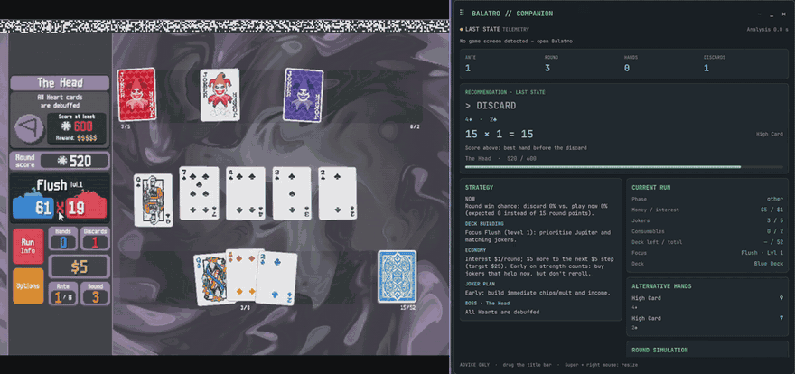
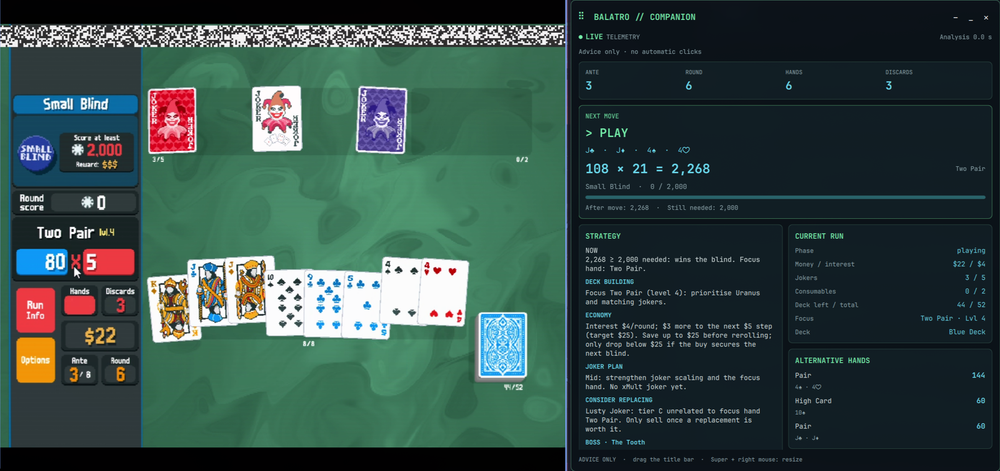
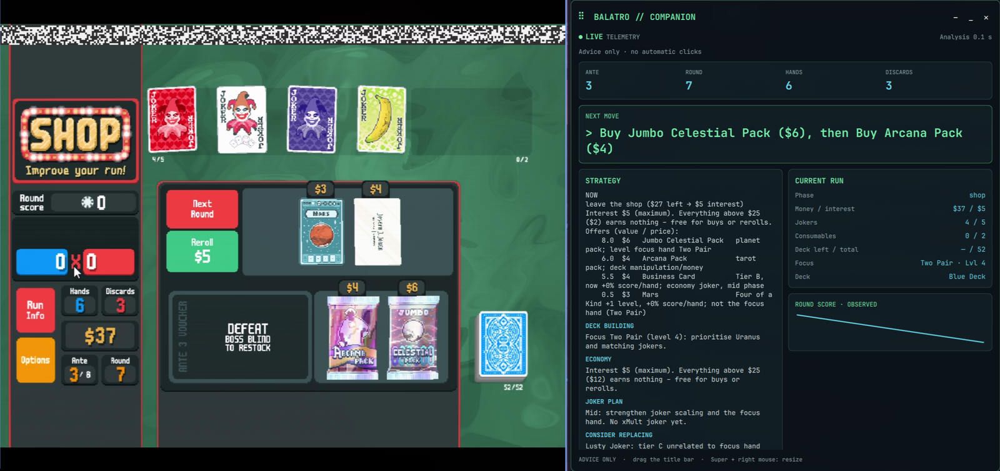
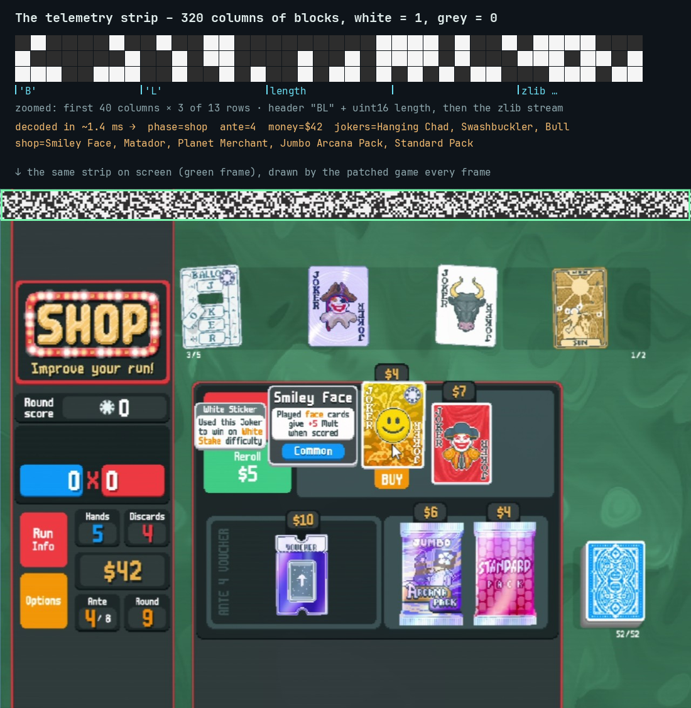

# Balatro Companion

**A score engine, live advisor and self-improving autopilot for [Balatro](https://www.playbalatro.com/) (vanilla 1.0.1).**
It reads the game state straight off the screen through a tiny "barcode" the patched game draws into its own picture,
computes the exact score of every possible play in the game's own order, and either tells you the best move in a
desktop widget or plays it for you – shop, packs, consumables and blinds included. After every run, Claude Opus
reviews the log and proposes tested code fixes, which are applied automatically.



> Unofficial fan project, not affiliated with LocalThunk or Playstack. You need your own copy of Balatro.
> The optional patcher modifies your local `Balatro.exe` (a backup is kept).

## Highlights

- **Exact scoring engine** – all 150 jokers, enhancements, editions, seals, boss blinds and the vanilla
  `evaluate_play` order (cards → held cards → jokers left to right, retriggers, Blueprint/Brainstorm).
  Verified against real games: across the logged runs the engine has predicted every scored hand exactly.
- **Round optimizer** – play vs. discard by Monte Carlo over the real remaining deck: it maximises the chance
  to win the *round*, not just the next hand, and knows about joker growth (Ride the Bus, Green Joker, Obelisk …).
- **Shop & economy strategy** – interest steps, rerolls with a concrete goal, joker tiers and synergies, packs,
  vouchers, tarot/spectral targets, skip tags – rules distilled from the [strategy research](docs/STRATEGY.md)
  and checked against the decompiled game source.
- **Telemetry barcode** – exact game state (including hidden joker counters, hand levels and the whole deck) in
  ~1.4 ms per frame, without memory reading or network access. Works through a game-streaming service.
- **Desktop widget** – a movable [Quickshell](https://quickshell.outfoxxed.me/) window with the next move,
  chips × mult, blind progress, alternatives, simulated win chances, shop plan and strategy notes.
- **Autopilot** – clicks through whole runs on Wayland/Hyprland via a virtual pointer (no root, no uinput),
  confirms clicks and joker/card drags against fresh telemetry, supports pause and single-step, and continues into Endless Mode after a win.
- **Replay & what-if lab** – a local browser interface for stepping through runs, inspecting failed actions and
  score mismatches, changing jokers/hand levels, and scoring selected cards without modifying recorded data.
- **Boss & deck planning** – simulate the next boss with its hand/discard/debuff restrictions and rank removals,
  copies and Standard Pack additions against draws from the full known deck.
- **Measured comparisons** – compare decisions and latency against a Git revision on fixed snapshots; compare
  completed games by version on matching seed, stake and deck.
- **Autolearner** – every run is logged with screenshots; after game over Claude Opus analyses it on a throwaway
  copy of the project, writes tests for its fixes, and a green patch is committed automatically
  ([changelog](docs/CHANGELOG.md)).



*The widget next to the game: Two Pair scores 2,268 of the 2,000 needed, the strategy panel explains the focus hand,
interest and a weak joker worth replacing.*



*In the shop the widget shows the whole plan with the value of every offer: the Jumbo Celestial Pack levels the focus
hand, and buying both packs still keeps the money above the $25 interest cap.*

## How it works

```text
 Balatro (Windows, Steam or a cloud PC stream)
   └─ patched main.lua: every frame, serialise the game state → zlib → draw it as a block strip
        │  (just pixels – survives screen capture and video streaming)
        ▼
 Linux / Wayland: grim captures the game window
        ▼
 localvision/telemetry.py  ── decode the strip (fallback: OpenCV + Tesseract recognition)
        ▼
 engine.py  ── exact scoring          optimizer.py ── play / discard (Monte Carlo)
 shop.py / strategy.py / packs.py ── shop, economy, packs, consumables, skip tags
        ▼
 widget (advice)  or  autopilot (virtual pointer clicks, confirmed via telemetry)
        ▼
 runs/<run>/ moves.jsonl + screenshots ── learn.py ── Claude Opus ── tested patch ── git commit
```

## The telemetry barcode

Balatro is a [LÖVE2D](https://love2d.org/) game: `Balatro.exe` is a Windows executable with a ZIP of Lua sources
appended. `patch_balatro.bat` (PowerShell) splits the file at the ZIP's end-of-central-directory record, appends a
small hook to `main.lua` and writes the executable back – always from the untouched backup `Balatro.exe.bak`, so
re-running it updates the hook and restoring the backup removes it.

The hook wraps `love.draw`. After the game has drawn its frame it:

1. **serialises** the state from the global `G` every 80 ms into compact tab-separated lines: phase, ante, round,
   money, blind and score, every hand card (rank, suit, enhancement, edition, seal, debuff, face-down), every joker
   with its live counters (`Ride the Bus +12`, `Obelisk x1.6` …), consumables, shop offers with prices and
   stickers, booster pack contents, hand levels, vouchers, the draw pile, the full deck and the skip tags;
2. **compresses** it with `love.data.compress("string", "zlib", …)` – zlib carries an Adler-32 checksum;
3. **frames** it as a packet: `"BL"` + payload length (uint16, big endian) + zlib bytes;
4. **draws** the packet bit by bit as a strip of blocks at the top of the window: 320 columns, each block
   `width/320 × height/240` (4×4 px at 1280×960), bright white `245` for a 1 and dark grey `45` for a 0,
   starting one block row below the top edge. A mid-game state needs 10–25 rows.



On the Linux side, [`telemetry.py`](balatro/localvision/telemetry.py) samples the centre of every block, picks the
threshold between the darkest and brightest sample, checks the `"BL"` magic and the length, and inflates the zlib
stream – a frame torn by the stream or covered by a notification simply fails the checksum and is skipped. It retries
with a ±2 px row offset to tolerate scaling, so the whole decode takes about 1.4 ms.

Why pixels? The game can run anywhere – on the same machine, under Proton, or on a cloud gaming PC that is only
visible as a video stream. Large high-contrast blocks survive video compression, there is no process memory to
read and no socket to open, and the state is exact: things the screen never shows (joker counters, hand levels,
the order of the draw pile) are in the packet. Without the patch, the
[local recognition](balatro/localvision/) falls back to template matching and OCR (~0.4 s, less complete).

## Requirements

- Python ≥ 3.12, [uv](https://docs.astral.sh/uv/) (or pip)
- For live mode, widget and autopilot: Linux on **Wayland with Hyprland** (≥ 0.55), `grim`, `tesseract`;
  the widget needs Quickshell ≥ 0.3 and `grim -T` window capture (grim ≥ 1.5). Built and tested on
  [Omarchy](https://omarchy.org/).
- For the barcode: Windows (or any machine that can run the PowerShell patcher on `Balatro.exe`)
- Optional: [Claude Code](https://claude.com/claude-code) for the autolearner (`claude` CLI with a subscription)
  or `ANTHROPIC_API_KEY` for Claude-based screenshot recognition

The scoring engine, optimizer and CLI work anywhere Python runs.

## Setup

```bash
git clone https://github.com/<you>/balatro-companion.git && cd balatro-companion
uv venv && uv pip install -e .            # numpy, opencv-python, pillow
uv pip install -e '.[claude]'             # optional: anthropic SDK for --vision claude/auto
```

Patch the game (recommended): copy `patch_balatro.bat` next to `Balatro.exe` on the Windows machine and run it.
It finds the Steam install, closes a running game, keeps `Balatro.exe.bak` and installs the hook. To uninstall,
rename the backup back to `Balatro.exe`.

Without the patch, download the card sprites once for the local recognition fallback:

```bash
.venv/bin/python -m balatro.localvision.assets
.venv/bin/python -m balatro.localvision.jokers
```

## Usage

```bash
.venv/bin/python -m balatro live              # advice in the terminal (+ notify-send)
.venv/bin/python -m balatro live --hud        # advice in the desktop widget
.venv/bin/python -m balatro live --auto       # the autopilot plays (logs runs, runs the autolearner)
.venv/bin/python -m balatro live --auto --paused  # start safely paused
.venv/bin/python -m balatro control step     # one action, then pause again
.venv/bin/python -m balatro control resume   # continuous play
.venv/bin/python -m balatro control pause    # stop before the next click/drag
.venv/bin/python -m balatro inspect          # replay, what-if editor, statistics and live controls
```

The window is found by title (`--window`, default `Balatro|Shadow PC`). Don't move the mouse over the game while
the autopilot runs; `Ctrl+C` stops it. The widget never clicks – `--hud` and `--auto` run as separate processes.
Pause/step controls also work from the lab. A step may include all selection clicks or drags needed for one action;
animation/menu frames do not consume it. A paused autopilot continues observing the game.

Automatic dragging requires valid telemetry and confirms every intermediate order before playing or using a
consumable. Without telemetry, the autopilot keeps the current joker order. Death's targets may require moving its
source card to the right first. Verdant Leaf is handled by selling the weakest sellable joker during the blind.
Cash Out waits for the real button after the payout animation.

Re-run the updated `patch_balatro.bat` on the game machine for **telemetry v3**: seed, stake, round resource/discard
counters, Cash Out readiness, permanent deck-card bonuses and Pillar history. Older strips remain readable; their
missing metadata is shown as unknown. The Python tests validate drags with simulated frames; real stream latency
and drag movement still need checking on the target game, preferably starting with `--auto --paused`.

### Replay and comparison

`inspect` serves only on `127.0.0.1`, opens an isolated-token URL in your default browser, and stops with `Ctrl+C`.
Choose a run, navigate with the slider or arrow buttons, and filter failed actions or score mismatches. Editing
the state, moving/replacing jokers or changing hand levels recalculates the recommendation. Selecting cards shows
their own score. **Restore recorded state** discards the edits; the original log stays unchanged.
The editor supports up to 12 hand cards/jokers and 256 deck cards to bound interactive calculation time.

```bash
.venv/bin/python -m balatro stats
.venv/bin/python -m balatro stats --compare 'VERSION_BEFORE' 'VERSION_AFTER'
.venv/bin/python -m balatro benchmark HEAD examples/flint_boss.json --samples 8
.venv/bin/python -m balatro benchmark HEAD ~/.local/share/balatro/runs/RUN --limit 20 --output comparison.json
.venv/bin/python -m balatro boss state.json --ante 8
.venv/bin/python -m balatro deck state.json
```

New logs record the Git revision plus a source fingerprint, seed, stake, deck, and action duration in `run.json`
and `moves.jsonl`. A restarted run that used different code is labelled `mixed`. Older runs have an unknown
version; no version history is guessed. Failed-action counts exclude menus/animations and repeated waiting messages.

The benchmark checks a detached archive of the named revision against the current checkout using exactly the same
snapshots, RNG seed and sample count. It does not change branches or apply patches. Its report measures changed
decisions and latency, **not** win-rate improvements. For the latter, play the same game seeds on both versions
with the same stake and deck, then use the matching-seed comparison. Logs that merely end mid-run are excluded
from completed-run rates. Old split logs may describe the same game, so historical aggregate rates are descriptive.

### Retention

On autopilot startup, routine screenshots and learner working copies older than **30 days** are removed. Logs,
metadata, reports, patches, failed-action/score-mismatch screenshots and their neighbours are kept. No cleanup runs
in advisor or replay mode. Use `live --auto --retain-days 0` to disable automatic trimming.

```bash
.venv/bin/python -m balatro prune --days 30         # preview only
.venv/bin/python -m balatro prune --days 30 --apply # remove the listed routine artifacts
```

Offline analysis from a JSON state or a screenshot:

```bash
.venv/bin/python -m balatro analyze examples/flush_blueprint.json          # best move
.venv/bin/python -m balatro analyze screenshot.png --save-state state.json # image → state → best move
.venv/bin/python -m balatro score examples/flint_boss.json 0 1 2 3 4       # score cards 0–4 (left to right)
.venv/bin/python -m balatro joker "Blueprint"                              # joker data
```

`state.json` (see [`examples/`](examples/) and `State.from_dict` in [`models.py`](balatro/models.py)): `hand`
(`"KH"`, `"10S"` or `{"rank", "suit", "enhancement", "edition", "seal", "debuff", "face_down"}`), `jokers`
(`{"name", "edition", "vars"}`), `hand_levels`, `hands_left`, `discards_left`, `hand_size`, `blind`,
`blind_chips`, `score`, `money`, `consumables`, `vouchers`, `deck_type`, optional `deck` / `full_deck`.

### Widget placement (Hyprland)

The widget is a normal floating window with the class `org.omarchy.balatro-hud`. A window rule keeps it
floating and out of the game's way, e.g. in `hyprland.lua`:

```lua
o.window("^org[.]omarchy[.]balatro-hud$", { float = true, size = { 720, 780 }, move = { 24, 50 } })
```

It captures only the game window's content (`grim -T` with Hyprland's `stableId`), so it can sit on top of the game.

## The autolearner

`live --auto` writes every move to `~/.local/share/balatro/runs/<timestamp>/` (`moves.jsonl` + a JPEG per move).
After game over:

1. [`learn.py`](balatro/learn.py) evaluates the run: score per blind, close calls, failed clicks, and re-scores
   every played hand – an engine mismatch becomes a regression test in `tests/learned/`.
2. Claude Opus gets the report, a one-line-per-move summary and the hypotheses from earlier runs, works on a
   throwaway git copy of the project and may change at most three things – each with a test, and only for a clear
   bug or a pattern seen in two runs.
3. The shared core suite (including HUD, telemetry and feature tests) is re-run on Opus' result, then again in
   the real project; only if both are green is the patch committed with a [changelog](docs/CHANGELOG.md) entry.
   Test failures, timeouts, interruptions and commit failures roll the patch back. Affected files with local
   changes are left untouched. Green tests establish correctness checks, not a stronger playing strategy.
4. The autopilot reloads itself on the new code at the start of the next run.

## Tests

The test files are standalone scripts:

```bash
.venv/bin/python -m tests         # complete suite, including available screenshot datasets
.venv/bin/python -m tests --core  # the same selection used by the autolearner
```

`tests/test_telemetry_hook.py` runs the Lua hook from `patch_balatro.bat` with `luajit` against mocked game
objects (skipped without `luajit`); the local-vision tests use labelled screenshots when available.

## Limitations

- Displayed scores use expected values for random effects. Round simulations roll Lucky cards, Bloodstone,
  Misprint, Space Joker and random money effects; a high expected score is not treated as a guaranteed win.
- Boss forecasts label limitations for future hidden cards, forced selections and random joker disables/shuffles.
  Draws are sampled rather than predicting Balatro's seeded RNG exactly.
- Card order uses a pair-swap search; deck-copy targeting checks six promising Death pairs. These searches can
  miss a better arrangement. Deck forecasts need the full deck and do not price every future shop or card creation.
- Local browser editing and automation controls are for the Linux desktop setup. Live drag calibration on an
  actual game/stream remains a hardware integration check.
- Live mode is Hyprland-specific (window lookup, pointer, capture); the engine and CLI are not.

## Project layout

| Path | What |
|---|---|
| `balatro/engine.py`, `balatro/jokers/` | scoring engine and all jokers |
| `balatro/optimizer.py` | best plays, discards, round simulation |
| `balatro/shop.py`, `strategy.py`, `packs.py` | shop plan, economy, packs and consumables |
| `balatro/localvision/` | telemetry decoder and the image-recognition fallback |
| `balatro/live.py`, `autopilot.py`, `pointer.py` | live loop, autopilot, Wayland virtual pointer |
| `balatro/hud.py`, `balatro/ui/shell.qml` | widget data model and Quickshell UI |
| `balatro/learn.py` | run evaluation and the Claude Opus autolearner |
| `patch_balatro.bat` | Windows patcher with the Lua telemetry hook |
| `docs/` | strategy research, changelog, media |

## License

[MIT](LICENSE). Balatro is © LocalThunk / Playstack; this project contains no game code or assets except the
screenshots used as test fixtures and illustrations.
